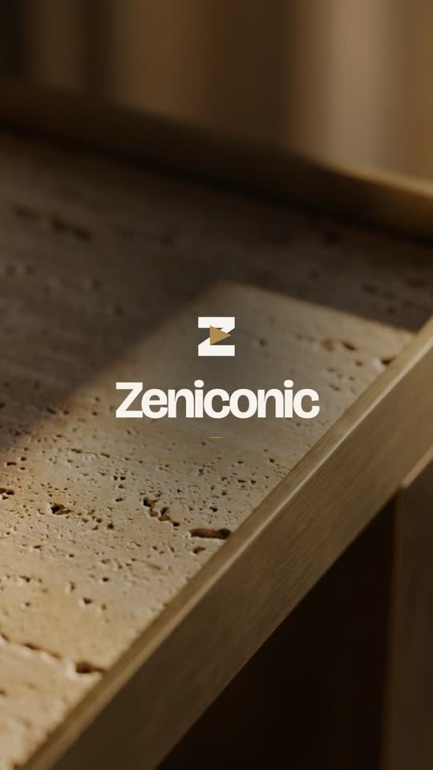
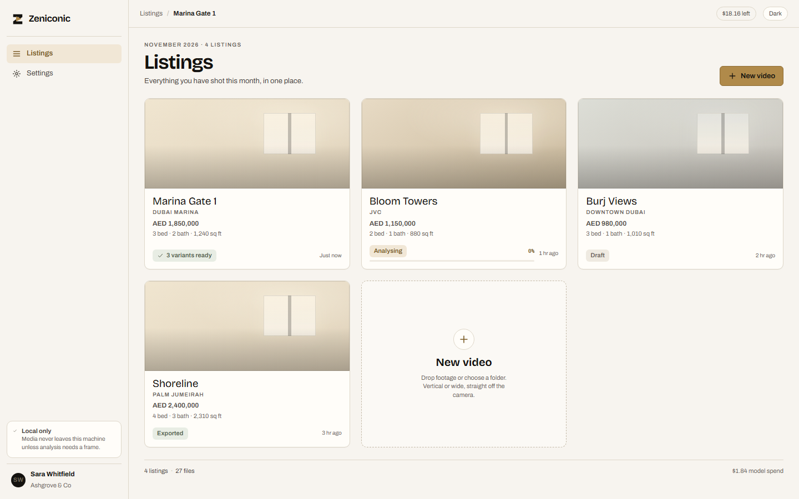
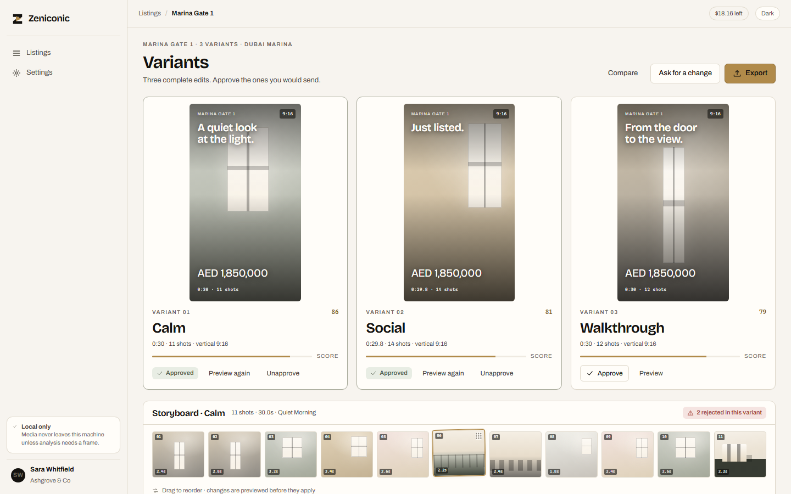
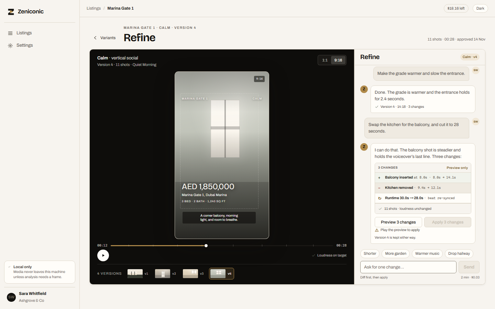

# Zeniconic

**Listings, made iconic.**



A local-first Windows app that turns a folder of raw property footage into finished,
platform-sized marketing videos. Built for an assistant who is a beginner at editing
and has no time: she drops in what she filmed, confirms the facts, and gets edits she
can approve or ask to change.



## What it does

- **Watches the footage.** One decode pass scores every shot for sharpness, shake,
  exposure and motion; a vision model names the room, the camera move, the selling
  points and the defects.
- **Builds complete edits, not clips.** Three looks (Calm, Walkthrough, Social), each
  a full 30-second cut with music, voice, captions, price card and end card.
- **Says why.** Every shot carries a reason; every rejected shot stays visible with
  the defect that sank it.
- **Studio voice.** ElevenLabs `eleven-v4` through OpenRouter, with a Settings
  gallery of bundled sample voices (matilda default) and emotion tags in the
  script. The agent's own recorded lines can lead and the studio voice can carry
  the rest. Kokoro remains the offline fallback, downloaded on request (92 MB,
  resumable).
- **Captions that look designed.** Bricolage 800 uppercase, two lines maximum, no
  background plate, accent on the most substantial word.
- **Aspect-aware.** 9:16, 16:9 and 1:1 from one edit; portrait into landscape uses a
  contained frame over a blurred fill rather than a hard crop.
- **Edits on request.** "Swap the kitchen for the balcony, cut to 28 seconds" becomes a
  validated patch to the edit, previewed before it applies.
- **Location-led marketing cut.** A 38-second beat sheet (hook → light → ritual →
  craft → space → lift → price → close) with slice/zoom/light transitions and a
  proximity card. Rendered in FFmpeg, not Remotion, so it takes minutes.
- **Local by default.** Media never leaves the machine except derivative frames and
  short audio slices sent to the model provider.

| Variants | Refine |
|---|---|
|  |  |

## Install

Download `Zeniconic-Setup-<version>-x64.exe` from Releases and run it. Windows may
show "Windows protected your PC" until the installer is code-signed; choose **More
info → Run anyway**.

First run asks for an OpenRouter API key. It is stored in Windows credential storage
and never written to a listing, a log, or the installer.

Voice is optional and explicit: **Settings → Voice model → Download** fetches Kokoro
82M (92 MB) once. The download is checksummed and resumable, so closing the app or
losing the connection costs only the bytes in flight. Everything else works without it.

Requirements: Windows 10/11 x64, ~600 MB disk for the app, ~2 GB during a render.

## Five-minute start

1. **New video** → choose the folder of clips.
2. **Check the facts** — price, beds, baths, address. A missing fact is better than a
   wrong one; export is gated on this.
3. **Pick the shapes** — 9:16 for social, 16:9 for portals, 1:1 for WhatsApp.
4. **Analyse** — roughly 90 seconds for five minutes of footage. You can leave it.
5. **Approve** the variants you would send, refine in chat if needed, then **Export**.

Files land in `%APPDATA%\Zeniconic\data\listings\<slug>\exports\`.

## How it is built

```
apps/ui            React 19 + Vite renderer, nine screens, light/dark
apps/desktop       Electron main, IPC, jobs, export pipeline
apps/render        Remotion composition: overlays, captions, crossfades
packages/edl       JSON Schema + runtime invariants — the contract
packages/planner   shot selection, pacing, overlays, deterministic EDLs
packages/render    FFmpeg filter graphs, profiles, segment cache
packages/review    deterministic checks before vision review
services/pipeline  analyse → plan → render orchestration
services/voice     Kokoro + presenter windows, ducking, mastering
```

Every stage is a module with tests. An EDL (edit decision list) is the single source
of truth: the chat edits it, the planner writes it, the renderer treats it as pure
input. That is why a change is a validated patch and a re-render, not a re-analysis.

See `docs/SPEC.md` for the full specification and `docs/BUILD.md` for the module map.

## Models and cost

| Stage | Model | Notes |
|---|---|---|
| Tagging | `google/gemini-3.8-flash` | contact sheets, `:floor` routing |
| Planning / chat | `openai/gpt-6-astra` | `:nitro`; tool calling |
| Review | `google/gemini-4-carbon` | rendered frames |
| Music | `google/lyria-3-pro-preview` | one bank, not per listing |
| Voice | Kokoro-82M (local) | Apache-2.0, CPU |

Typical listing: **$0.20–0.60** in model spend. Rendering is local and free; AI
upscaling is opt-in and priced per file.

## Develop

```powershell
npm install
npm run dev            # Electron + Vite
npm test               # unit + integration (700+)
npm run typecheck
node scripts/e2e.mjs   # nine routes in headless Chrome
npm run dist           # NSIS installer → release/
```

The real listing used for calibration is in `data/listings/marina-gate-1`; see
`docs/PROTOTYPE.md` for the end-to-end run and `docs/RESEARCH.md` for the decisions
behind tagging, rendering and voice.

## Honest status

Working end to end on real footage: indexing, vision tagging, planning, 30-second
edits, the 38-second marketing cut, Remotion overlays, presenter + studio voice,
captions, crossfades, export, installer, splash and auto-update. Verified: 820+
tests, 66/66 route checks, both themes AA, 30.000 s exports at −14/−16 LUFS with
SRT and cover, and a 198 MB installer that launches on a clean profile.

Not yet wired: the remix engine (scene split, Scribe transcription, ordering
presets) is built and tested in `services/remix` but has no screen or IPC yet.
Also open: code signing, licensed music for delivery, Arabic voice, in-memory job
queue, batch export, and real shot data in the shot review screen. New sessions
should start with `AGENTS.md` and `docs/HANDOFF.md`.

## Updates

The app checks GitHub Releases on launch and prompts before restarting. Source is
private; release binaries live in a public releases repository so no token ever
ships to a client machine. See `docs/UPDATES.md`.

## Licences

Remotion (free ≤3 people), FFmpeg, Kokoro (Apache-2.0), Bricolage Grotesque and
Archivo (SIL OFL). Full list and obligations: `THIRD-PARTY.md`. Music licensing:
`docs/MUSIC-LICENCES.md`.

---

Private repository. © 2026 Zeniconic.
